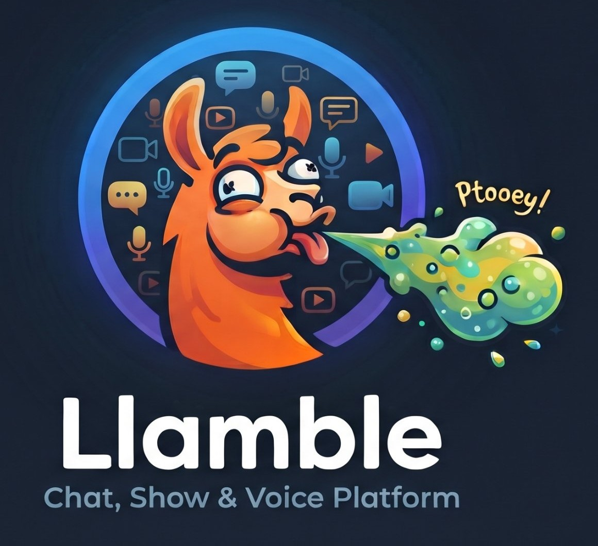

# Llamble

<p align="center"></p>

A self-hosted chat server for your clients: text, voice and video. Rust server on TrueNAS, Windows desktop app (Electron), voice/video/screen share through LiveKit (bundled), and an AI bot powered by llama.cpp.

```
llamble/
  server/        Rust (Axum + SQLite) — API, WebSocket gateway, files, link previews, GIF library, AI bot
  client/        Electron + React desktop app (the same UI is also served as a web app by the server)
  deploy/        TrueNAS compose YAML (self-contained)
  .github/       CI: builds the server image (GHCR) + Windows installer
  tests/         API smoke test, bot test, mock llama server
  Dockerfile     Builds the server image (web client + ffmpeg included)
```

## Features

- **Servers, channels, categories, roles and permissions** (16 permission bits, hoisted roles, colors), kicks and bans, nicknames, invites with expiry and max uses
- **Messages**: markdown (bold, italic, underline, strike, `code`, code blocks, quotes, headings, ||spoilers||, masked links), replies, edits, deletes, reactions, @mentions with autocomplete, `:emoji:` autocomplete, typing indicators, unread markers and mention badges, per-channel search, jump to message
- **Files**: drag-drop or paste, up to 10 per message, upload progress, spoilers, image grid and lightbox, inline video (seekable, with range requests and ffmpeg poster frames), audio player, file cards. Thumbnails are generated server-side.
- **Link previews**: OpenGraph cards, direct image/video/GIF links, YouTube (plays via youtube-nocookie only after you click). Previews and images go through an SSRF-safe, HMAC-signed proxy, so clients' IPs never reach outside sites.
- **GIFs**: a self-hosted, searchable GIF library with favorites. You can save any GIF from chat, or import from a Tenor/Giphy link (it's downloaded once). No GIF API is called at runtime.
- **Voice/video**: voice channels, DM calls with ringing, camera, screen share (pick a screen or window, up to 1440p30 or 1080p60, with system audio on Windows), per-user volume, speaking rings, mute/deafen, global hotkeys (Ctrl+Shift+M / Ctrl+Shift+D), and device picker with mic test. Opus at 96 kbps by default (configurable up to 256).
- **Desktop**: tray, minimize to tray, notifications plus taskbar flash for DMs and mentions, unread count in the title, `llamble://invite/CODE@host` links, spellcheck menu, autostart option
- **AI bot** (see below)
- **Admin**: one-time admin invite on first boot, account invites, password resets, user deletion, device list. A janitor cleans orphaned uploads, stale cache and expired invites.

## The AI bot

Each server can turn the bot on under **Server Settings → AI Bot**, and give it a personality prompt there. It replies when:

- someone **@mentions** it (`@Llamble …`, which autocompletes in the composer)
- someone **replies** to one of its messages
- a message **starts with its name**: `llamble, …`, `hey llamble …`
- it's a **DM** with the bot (Home → "Chat with Llamble")
- the channel is marked **always-on** (it then answers every message)

It reads the last ~40 messages for context, shows a typing indicator, streams its reply live into the message, and hides `<think>` reasoning from models like Qwen3.

**Where it runs: a shared GPU pool.**

1. **Members' GPUs.** Anyone allowed can offer their graphics card from the desktop app (**User Settings → AI & GPU**, off until they accept a consent screen). The app runs `llama-server` pinned to that PC's best card. The server always uses the **best available GPU among everyone currently lending**:
   - A lender's PC only counts as *available* while its owner is **away** (no input for N minutes, or locked; on by default) and its GPU **isn't busy with something else**, like a game (over 30% use).
   - While paused, the app **unloads the model to free the VRAM**, and the server switches to the next-best GPU.
   - When the owner is idle again it reloads and rejoins. Logging off hands over immediately.
2. **The server itself.** The built-in model from setup is the fallback whenever no lent GPU is available.

**Admin switch:** **Settings → AI Model → GPU sharing** sets who may lend a GPU: *Off (server only)*, *Admins only* (default), or *Any member*. It also shows every lent GPU live: in use, standby, or paused and why.

**Privacy rule (built in):** a lent GPU only ever receives conversations from channels its owner can already read.

Recommended for your 4090: a Qwen3-14B or Gemma-3-27B class instruct GGUF at Q4_K_M with 16k context. Use the **CUDA** build of llama.cpp for Windows (from the llama.cpp GitHub releases). The NAS CPU fallback should use a small 3–4B Q4 model.

## Deploy on TrueNAS SCALE (Install via YAML)

GitHub Actions builds the server image (`ghcr.io/outcomegit/llamble:latest`, public) and the Windows installer on every push to `main`. TrueNAS pulls the image, so nothing is copied to the NAS and no registry login is needed. The image includes everything: the web client, llama.cpp for the AI bot, and LiveKit for voice/video (Llamble runs and configures it itself, with its own generated keys).

1. **Apps → Discover Apps → ⋮ → Install via YAML.** Name it `llamble` and paste `deploy/truenas-compose.yaml` **as-is**. There's nothing to fill in. Storage (`llamble-data`) is created automatically on your apps pool.
2. **Run setup:** open `http://NAS_IP:8090` in a browser, or enter that address in the Llamble app. A fresh server shows the setup wizard:
   - **Admin account:** creates the owner. Setup locks once it exists.
   - **First server name:** optional; the AI bot is switched on in it.
   - **AI model:** pick from the list (sizes and RAM needs shown) or paste any Hugging Face GGUF repo and choose a quantization. It downloads in the background with progress, then runs on the NAS. Change it later under **Settings → AI Model**.
3. **Desktop app:** download the installer from this repo's Releases (`Llamble-Setup.exe`). It updates itself.
4. **Android app:** download `Llamble.apk` from the same Releases and open it on the phone (allow "install unknown apps" once). It offers its own updates. Built from `android/`: a small Java app with no libraries that runs the same web app.

Every other server setting is in the app for admins: **Settings → Server** (upload limit, link previews, who can create servers, bot name, recording), **AI Model** (model and GPU sharing), and **Remote Access**.

### Accounts, kids and roles

- **Account levels:**
  - **Master Admin:** whoever ran setup. Runs the server itself: Server, AI Model, Remote Access, and admin levels. Can hand the role to someone else.
  - **Admins:** manage accounts, passwords and kid accounts.
  - **Users.**
  - **Kids.**
- **Server roles:** every server gets **Admin / Supervisor / Moderator / Guest** below its Owner.
  - Supervisor is meant to be tuned: tick the powers you want them to have.
  - Guest can read and listen but not post or talk.
- **Kid accounts:** made in **Settings → Family**, no invite needed. Each kid is linked to one or more parent accounts (any regular account). Parents can:
  - read all the kid's chats, DMs included
  - approve who the kid may DM, and which servers they may join (servers run by chosen people are OK'd automatically)
  - take the kid out of any server
  - set quiet hours and kid-safe AI, and choose whether the kid may delete messages
- **Forgot password:** three ways back in.
  - **Recovery code:** shown once at sign-up; make a new one in My Account.
  - **Ask:** an admin, or a kid's parent, approves, and the waiting screen then sets the new password.
  - **Email link:** works once the Master Admin adds an email account in Settings → Server.
- **Clearing messages:**
  - select-and-delete many
  - clear a channel
  - delete everything one person wrote
  - auto-delete after N days (per channel)
  - anyone can clear their own AI chat

**Forgot the admin password?** In TrueNAS open **Apps → llamble → Shell** (the `>_` icon next to the container) and run `llamble-server reset-password` to list accounts, then `llamble-server reset-password <username>` for a temporary password. Other users' passwords can be reset by an admin in **Settings → Instance Admin**.

**Updating the server:** push to `main`, wait for the Actions build, then **Update** the app in TrueNAS (`pull_policy: always`). Models and data survive updates.

### Access from outside your house (Settings → Remote Access)

Each install uses its own address and, optionally, its own relay. Nothing goes through a shared Llamble service. Pick one:

- **Home only** (default): only devices on your network can connect.
- **Direct:** your router forwards ports to the NAS.
  1. Choose how your address stays pointed at your home IP: **Namecheap**, **Cloudflare** (API token), **DuckDNS** (free `yourname.duckdns.org`, no domain purchase needed), **another provider's update URL** (No-IP, Dynu, afraid.org, …), or **I handle it myself** (router DDNS or a static IP). The app shows the steps for whichever you pick.
  2. Enter your address (e.g. `chat.example.com`) and the provider's password/token/URL.
  3. On your router, forward **443/tcp → NAS:8443**, **7881/tcp → NAS:7881**, and **7882/udp → NAS:7882**.
  
  Llamble re-checks every 10 minutes and moves calls to the new IP when it changes. Your home IP is visible to anyone who looks up the address.
- **Through your own relay:** hides your home IP; no router changes.
  1. Rent a small VPS with Docker (Oracle Cloud's free tier works, or about $4–6/month elsewhere).
  2. Run the one-line `docker run … llamble-server relay` command that the app shows. It contains your server's private relay key.
  3. Wherever your DNS is managed, point your address's A record at the VPS's IP (once), then enter the VPS IP and your address in Llamble.
  
  Your NAS dials out to the relay and proves it has the key. Visitors' HTTPS and call traffic then passes through that connection. HTTPS is end-to-end: the VPS never holds your certificate.

In both modes, Llamble gets and renews a **Let's Encrypt** certificate on its own, and serves the app, files and call setup on one HTTPS port. People outside use **https://chat.example.com** in the app or any browser, including Chromebooks. New invites use that address automatically. At home, `http://NAS_IP:8090` keeps working.

Accounts are invite-only, passwords are hashed, and everything outside is HTTPS. Keep TrueNAS and Llamble updated.

## Desktop app (Windows)

```sh
cd client
npm install
npm run dev        # dev mode (Vite + Electron)
npm run dist       # builds release/Llamble-Setup.exe locally (CI publishes releases automatically)
```

The installer registers the `llamble://` protocol, so invite links open the app.

## Server configuration (env)

Optional. Admins change the day-to-day settings in the app; these environment variables are only first-boot defaults or advanced overrides.

| Var | Default | |
|---|---|---|
| `LLAMBLE_DATA` | `./data` | SQLite DB, files, thumbnails, proxy cache, secret key |
| `LLAMBLE_BIND` | `0.0.0.0:8080` | |
| `LLAMBLE_MAX_UPLOAD_MB` | `500` | first-boot default (Settings → Server) |
| `LLAMBLE_GUILD_CREATE` | `admin` | first-boot default (Settings → Server) |
| `LLAMBLE_UNFURL` | `1` | first-boot default (Settings → Server) |
| `LLAMBLE_BOT_NAME` | `Llamble` | first-boot default (Settings → Server) |
| `LLAMBLE_BOT_WORKERS` | `admins` | first-boot default for GPU sharing (Settings → AI Model) |
| `LLAMBLE_BOT_MAX_TOKENS` | `1024` | |
| `LIVEKIT_URL` / `LIVEKIT_API_KEY` / `LIVEKIT_API_SECRET` | — | advanced: use your own external LiveKit instead of the built-in one |
| `LLAMBLE_LLAMA_URL` | — | advanced: use an external llama-server instead of the built-in one |
| `HF_TOKEN` | — | optional: Hugging Face token for gated models |
| `LLAMBLE_IMAGE` | `ghcr.io/outcomegit/llamble:latest` | image name shown in the relay command (set it if you publish your own build) |
| `LLAMBLE_WEB_DIR` | `/app/web` in Docker | also serves the web client at `/` |
| `LLAMBLE_BOOTSTRAP_INVITE` | random | fixed first admin invite code |

**Backups:** everything lives in the `llamble-data` volume (`llamble.db` is SQLite in WAL mode), which sits inside the apps pool's `ix-apps` dataset. Snapshot that dataset.

## Tests

```sh
cd server && cargo build && cargo test   # unit tests
tests/run_all.sh                         # every API suite against a fresh server, with stand-ins for
                                         # llama-server, Hugging Face, Namecheap, LiveKit and a relay
```

## Not done yet / next ideas

- Image and video generation in chat (stable-diffusion.cpp: FLUX.2-klein / Z-Image for images, LTX for video) on lent GPUs
- Show recording: multi-camera with auto-switching, director mode, overlays, per-person consent
- Per-channel permission overrides (only server-wide roles today)
- Message pins, threads, custom server emoji, link to a specific message
- Push notifications for phones (an Android app would reuse the web UI)
- Bot in voice channels (whisper.cpp in, TTS out)
- E2E encryption for DMs

## Licence

Llamble is **source-available**: free to use and to self-host, with the code public so anyone can
check what it does. It's licensed under the [PolyForm Shield License 1.0.0](LICENSE.md), which
doesn't allow using it to build or sell a competing service. [LICENSING.md](LICENSING.md) explains
what's allowed in plain English. Packs, themes and games from the Llamble Store have their own terms.

Third-party software and its licences: [client/src/legal/third-party-licenses.txt](client/src/legal/third-party-licenses.txt)
(regenerate with `python3 tools/third_party_licenses.py` after changing dependencies).
Contributions: see [CONTRIBUTING.md](CONTRIBUTING.md).
